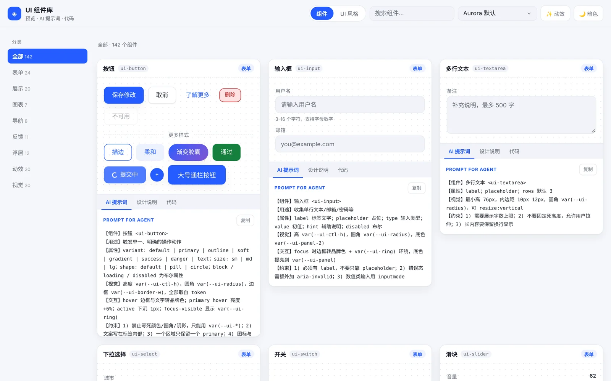
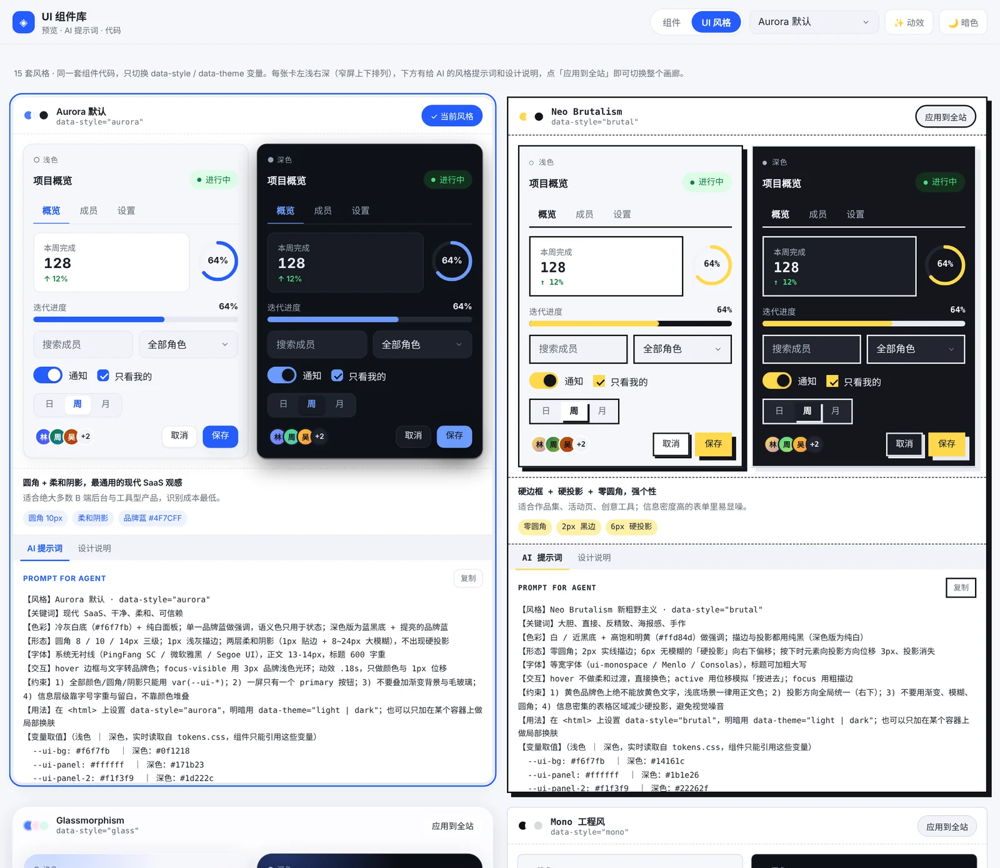
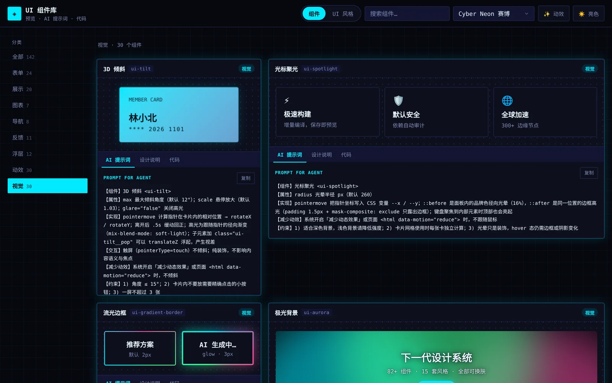
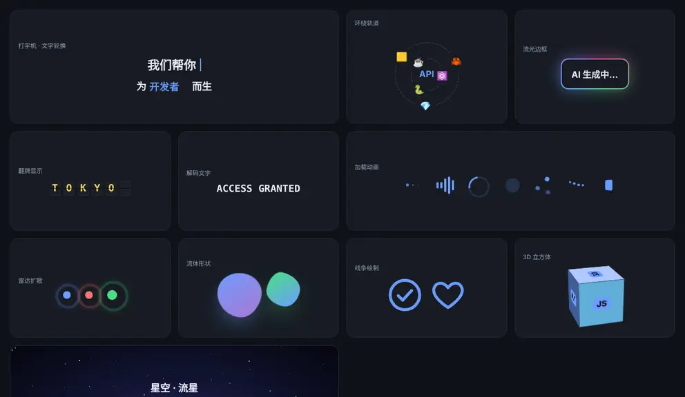
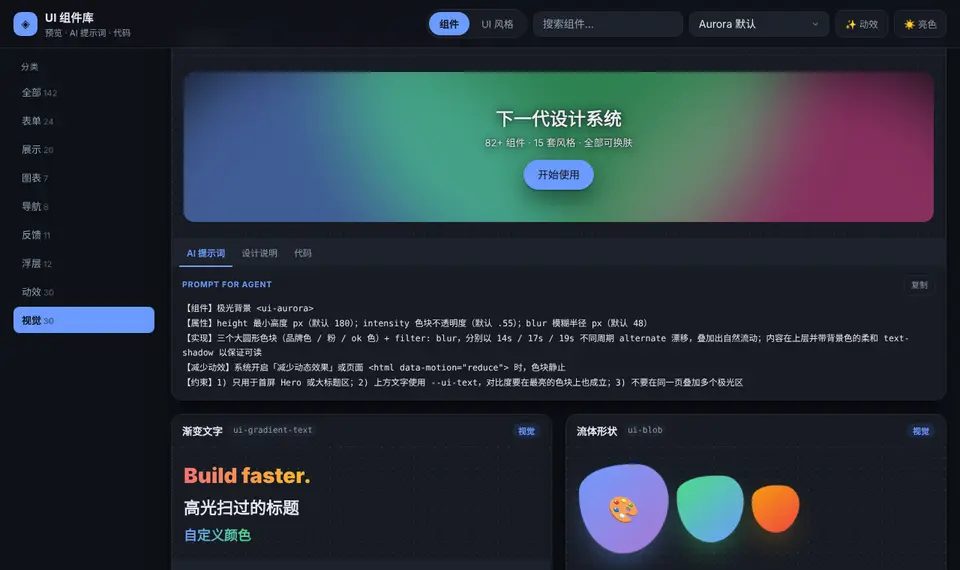
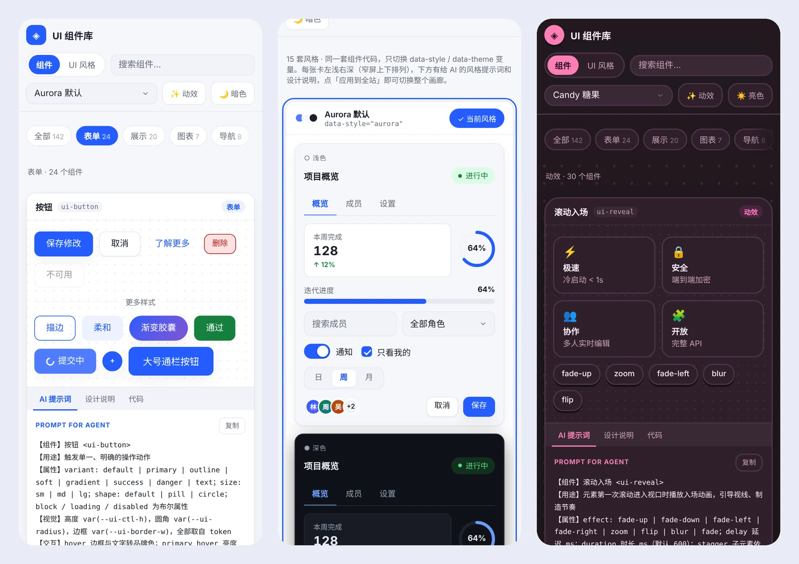

# UI 组件库 · 画廊

[](https://github.com/7015725/ui-catalog/actions/workflows/test.yml)


[](./LICENSE)

一套**零运行时依赖**的原生 Web Components 组件库：**167 个组件 · 21 套 UI 风格（各含浅色 / 深色）· 20 个界面模板**，
每个组件和模板都配有「预览 / AI 提示词 / 设计说明 / 代码」，可以直接把提示词交给 AI Agent 生成同风格界面。

🔗 **在线预览：[7015725.github.io/ui-catalog](https://7015725.github.io/ui-catalog/)**　·　回归测试页：[test.html](https://7015725.github.io/ui-catalog/test.html)

📐 **贡献前必读：[约束、要求与验收标准](docs/SPEC.md)**（新增组件 / 风格 / 模板都按它做、按它验）



<table>
<tr>
<td width="50%"><b>21 套 UI 风格</b>：同一套组件，只切换 <code>data-style</code> / <code>data-theme</code><br></td>
<td width="50%"><b>深色 + 赛博风格</b>：视觉效果分类<br></td>
</tr>
<tr>
<td><b>动效</b>：30 个动画组件，全部尊重「减少动态效果」<br></td>
<td><b>视觉效果</b>：30 个，颜色随风格自动变化<br></td>
</tr>
</table>



| 分类 | 数量 | 例子 |
|---|---|---|
| 表单 | 30 | 按钮、输入框、多选下拉、级联、穿梭框、验证码、手写签名、旋钮、手势密码、滑块验证、长按确认 |
| 展示 | 22 | 卡片、表格（窄屏变卡片）、时间线、轮播、日程月历、评论、拖拽排序、表情回应 |
| 图表 | 9 | 折线、柱状、环形、仪表盘、漏斗、热力日历、雷达图、词云（纯 SVG / CSS） |
| 导航 | 8 | 标签页、步骤条、顶部导航（容器窄时折叠）、侧边菜单、目录锚点 |
| 反馈 | 11 | 提示条、进度、环形进度、结果页、通知、倒计时、公告横幅 |
| 浮层 | 12 | 对话框、抽屉、下拉菜单、命令面板（Ctrl/⌘ + K）、右键菜单、气泡确认 |
| 动效 | 30 | 滚动入场、打字机、数字滚动、卡片堆叠、翻牌、弹性拖拽、图标变形… |
| 视觉 | 30 | 3D 倾斜、光标聚光、流光边框、极光、粒子、镭射卡、前后对比、放大镜… |
| 趣味 | 15 | 刮刮卡、大转盘、老虎机、3D 骰子、抛硬币、翻页时钟、翻牌配对、迷你钢琴、拆礼盒、拉绳台灯、播放器、天气卡、便利贴墙、虚拟摇杆 |

## 在你的项目里使用（无需下载、无需构建）

仓库是公开的，可以直接通过 jsDelivr CDN 引用。引入一个样式文件 + 一个脚本，就能用全部组件：

```html
<!-- 1. 设计变量（颜色 / 圆角 / 阴影；当前 main 含 21 套风格，固定版本以发布内容为准） -->
<link rel="stylesheet" href="https://cdn.jsdelivr.net/gh/7015725/ui-catalog@v1.2.0/src/styles/tokens.css">
<!-- 2. 注册全部组件 -->
<script type="module" src="https://cdn.jsdelivr.net/gh/7015725/ui-catalog@v1.2.0/src/components/index.js"></script>

<!-- 3. 选一套风格和明暗，然后直接写标签 -->
<html data-style="nord" data-theme="light">
  <ui-button variant="primary">保存</ui-button>
  <ui-input label="用户名" placeholder="请输入"></ui-input>
  <ui-line-chart labels="1月,2月,3月" series='[{"name":"营收","data":[12,18,26]}]'></ui-line-chart>
</html>
```

- `@v1.2.0` 是固定版本（推荐，永久缓存、不会突然变化）；想始终用最新代码可以换成 `@main`（CDN 缓存最长约 12 小时）。
- 只想要一部分组件时，把 `components/index.js` 换成具体文件，例如 `components/form.js`、`components/charts2.js`。
- 函数式 API 会挂在 `window` 上：`uiToast()`、`uiNotify()`、`uiConfetti()`。

## 为什么是零依赖

- 没有构建步骤：组件是原生自定义元素（Custom Elements），浏览器直接跑。
- 没有框架绑定：以后要包成 Vue / React 组件只是加一层壳。
- 换肤靠 CSS 变量：同一份组件代码，改 `data-style` / `data-theme` 就换风格，不改一行组件逻辑。
- 运行时没有 npm 依赖，也不需要构建；Playwright 仅用于开发自动化测试，不随页面加载。

## 启动（带实时刷新）

需要 Node.js 18+（无需 `npm install`，零依赖）。

```bash
npm run dev          # 启动并自动打开浏览器
# 或：node dev-server.mjs
# Windows 也可以直接双击 start-dev.bat
```

打开 http://127.0.0.1:5173 （测试页：/test.html）。

- 改 `.css` → 样式即时热替换，页面不刷新
- 改 `.js` / `.html` → 页面自动刷新，并保留滚动位置
- 端口被占用时会自动顺延到下一个端口

没装 Node 时的备用方式（无实时刷新）：`python3 -m http.server 5173`

> 必须走 HTTP。直接双击 `index.html` 用 `file://` 打开时，浏览器会因 CORS 拒绝加载 ES Module。

## 目录

```
index.html                 页面外壳（顶栏 / 侧栏 / 主区）
src/
  app.js                   画廊逻辑：视图切换、筛选、搜索、面板、复制
  styles/
    tokens.css             ★ 设计变量：主题(颜色) + 风格(形态)
    app.css                展示页自身的布局样式
  lib/
    positioner.js          Layer：portal + fixed 定位 + 空间不足翻转
    focus.js               FOCUSABLE 选择器 + trapTab 焦点陷阱
    motion.js              reduced() / onVisible() / loop()：减少动效判断、进入视口、可自动暂停的动画循环
  components/
    base.js                UIElement 基类 + register() + cssRegistry
    form.js                ui-button / input / textarea / select / switch / slider / checkbox / radio
    display.js             ui-tag / badge / avatar / card / stat
    nav.js                 ui-tabs / breadcrumb / steps / pagination
    feedback.js            ui-progress / spinner / skeleton / empty / alert
    overlay.js             ui-dropdown / ui-tooltip + toast() 全局 API
    datepicker.js          ui-datepicker（月历面板）
    tree.js                ui-tree（JSON 递归渲染）
    modal.js               ui-modal（遮罩 + 焦点陷阱 + 节点搬运）
    drawer.js              ui-drawer（贴边全高面板）
    popover.js             ui-popover（可放交互内容的气泡）
    table.js               ui-table（columns/rows 传 JSON）
    accordion.js           ui-accordion（单开/多开折叠）
    control.js             ui-segmented / ui-rate
    more-form.js           ui-number / tag-input / otp / upload / color / chips
    more-display.js        ui-timeline / avatar-group / descriptions / list / carousel / code / kbd / divider
    more-nav.js            ui-navbar（容器自适应）/ ui-menu / ui-ring / ui-result
    more-form2.js          ui-password / range（双滑块）/ search（联想）/ option-cards
    charts.js              ui-sparkline / bar-chart / donut / heatmap（零依赖图表）
    more-misc.js           ui-profile / pricing / bottom-nav / command（⌘K）/ countdown / banner / status
    more-form3.js          ui-multi-select / cascader / transfer / input-group
    more-display2.js       ui-image（灯箱）/ comment / calendar
    charts2.js             ui-line-chart / gauge / funnel
    more-overlay.js        ui-anchor / split-button / context-menu / popconfirm + uiNotify()
    motion.js              动效：ui-reveal / typewriter / count-up / marquee / text-anim / ripple / flip-card / animate / loader + uiConfetti()
    effects.js             视觉：ui-tilt / spotlight / gradient-border / aurora / gradient-text / pattern / blob / particles / magnetic / shine
    motion2.js             动效：scramble / rotating-text / odometer / draw-svg / morph-icon / like-button / daynight / parallax / scroll-progress / card-stack
    motion3.js             动效：expand / orbit / ping / swap / hover / split-flap / checkmark / scroll-hint / spring-drag / grid-wave
    effects2.js            视觉：glass-card / neon-text / grain / mesh-gradient / glitch / holo / wave / starfield / grid-beam / border-beam
    effects3.js            视觉：meteors / image-compare / lens / image-filter / text-3d / gooey / cursor-trail / cube / ribbon / snow
    fun.js                 趣味：scratch / lucky-wheel / slot-machine / dice / flip-clock / pull-lamp / coin-flip / memory-game / piano / gift-box / music-player / weather / battery / sticky-notes / joystick
    fun2.js                趣味控件：signature / knob / pattern-lock / slide-verify / emoji-rate / hold-button / sortable / reactions / radar / word-cloud
    canvas-ui.js           Canvas 绘制界面：ui-cv-dash（数据大屏）/ ui-cv-game（游戏菜单 + HUD）/ ui-cv-board（白板画布）
    index.js               统一注册 + 类表（供生成属性文档）
  data/
    catalog.js             ★ 唯一数据源：demo + AI 提示词 + 设计说明（第一批）
    catalog-more.js        第二批组件元数据（wide: true 表示宽屏占两列）
    catalog-more2.js       第三批组件元数据（含「图表」分类）
    catalog-more3.js       第四批组件元数据
    catalog-motion.js      「动效」「视觉」第一批（各 10 个）
    catalog-motion2.js     「动效」「视觉」第二批（各 20 个）
    catalog-fun.js         「趣味」分类 + 趣味控件（25 个）
    styles.js              风格预设的元信息（含代表色 swatch）
    style-guides.js        每套风格的 AI 提示词 + 设计说明（风格页展示；提示词末尾自动附上从 tokens.css 实时读取的变量值）
    templates.js           ★ 界面模板入口（字段说明见文件头）：TPL_CATS 分类 + 全部模板
    templates-shared.js    模板共用骨架样式（屏幕 / 滚动区 / 区块标题 / 横滑 / 占位图）
    templates-app.js       移动 APP 模板（6 个）
    templates-mobile.js    系统 APP 原创风格灵感预览（6 个）
    templates-web.js       Web 页面模板（4 个）
    templates-liquid-glass.js 液态玻璃经营后台（原生 Web 模板）
    templates-canvas.js    JS 绘制模板（3 个）
scripts/
  check.mjs                跨平台语法检查（npm run check）
  run-tests.mjs            无头浏览器跑全部回归用例（npm test，CI 同款）
  test-mobile-previews.mjs 系统 APP 画廊级验证（npm run test:mobile）
  test-liquid-glass.mjs    液态玻璃完整 HTML 代码出口（npm run test:liquid）
  test-accessibility.mjs   全风格/主题/宽度/视图矩阵（npm run test:a11y）
  test-validation-guards.mjs 验收脚本负例与真实正常页（npm run test:guards）
docs/SPEC.md              ★ 项目第一约束与验收标准
examples/liquid-glass-dashboard.html 原始独立单页（内嵌资源与字体许可）
docs/screenshots/          README 用的截图与动图
.github/workflows/test.yml 每次推送自动跑语法、回归、系统 APP、验收脚本负例与全风格矩阵
```

## 界面模板（整页布局 + 操作逻辑）

顶栏切到「界面模板」，可以看到 20 个整页模板。和组件卡片一样，每个模板都有 **AI 提示词 / 设计说明 / 代码** 三个标签页，
预览可直接操作，并在手机框内独立滚动。**系统 APP 使用各自推荐风格，只跟随全站明暗；其余模板继续跟随全站风格与明暗。** 明暗切换不重建系统 APP，也不丢失当前筛选、勾选、连接或日期状态。

| 类型 | 预览方式 | 模板 |
|---|---|---|
| 移动 APP（6） | 手机框，375 宽，内容区独立滚动 + 底部导航 | 电商首页、外卖 / 本地生活、社交动态、银行 / 理财、健身健康、智能家居 |
| 系统 APP（6） | 手机框，独立滚动；各自风格 + 全局明暗 | 系统设置、文件管理、提醒事项、设备中心、原子日程、轻量笔记 |
| Web 页面（5） | 浏览器框，可切换 桌面 / 平板 / 手机 宽度 | 后台仪表盘、产品落地页、内容门户 / 博客、邮件 / 三栏工作台、液态玻璃后台 |
| JS 绘制（3） | 浏览器框，界面主体画在 `<canvas>` 上 | 监控数据大屏、游戏菜单 / HUD、白板 / 画布编辑器 |

### 液态玻璃后台入口与操作

顶栏「界面模板」→「Web 页面」→「液态玻璃后台」（`liquid-glass-dashboard`），也可搜索「液态玻璃」。原生预览复用库组件，跟随全局风格与明暗，不使用 iframe。

- 悬浮岛侧栏与底部 Dock 联动切换页面；桌面侧栏可收起与展开。
- 收入趋势、客户结构、目标追踪、产品表现、收入来源、订单动态六个模块可原位展开；其它模块收为缩略条，支持切换详情及关闭 / Esc 收回。
- 时间胶囊选择今日 / 本周 / 本月 / 本季，同步更新本地示例指标和图表；方向键、Home / End、Enter / Space 与 Esc 可完成选择。
- 搜索按钮或模板区域 K / Ctrl+K 打开命令面板，实时过滤并高亮；上下键选择、Enter 跳转、Esc 关闭并归还焦点。
- 「代码」导出可独立运行的完整 HTML，包含当前风格、明暗、容器查询与本地动效导入；迁移时调整 `src/styles/tokens.css`、`src/components/index.js` 和 `src/lib/motion.js` 三条资源路径。
- 卡片的「打开原始单页」链接保留最初的独立 HTML：内嵌 CSS、JS、图标和 Manrope 字体及许可，不依赖 CDN；它不跟随画廊换肤。

全部数字和订单均为固定本地示例，不请求外部接口，不读取真实经营数据。

### 系统 APP 入口与操作

顶栏「界面模板」→ 分类「系统 APP」；也可搜索风格名或页面名。

| data-style | 风格灵感 | 示例页面 / 模板 ID | 可操作主路径 |
|---|---|---|---|
| `miui` | MIUI / HyperOS | 系统设置 · `miui-settings` | 搜索设置与空结果、开关状态反馈、展开设备概览 |
| `coui` | COUI（参考 ColorOS 形态） | 文件管理 · `coui-files` | 分类与搜索组合过滤、文件选择与详情 |
| `oneui` | One UI | 提醒事项 · `oneui-tasks` | 勾选/撤销、剩余数量与进度、待办筛选与重置 |
| `harmonyos` | HarmonyOS | 设备中心 · `harmonyos-devices` | 选择设备、连接/断开本地示例、读屏反馈 |
| `originos` | OriginOS | 原子日程 · `originos-agenda` | 日期选择同步日程与模块摘要、空日程 |
| `flyme` | Flyme | 轻量笔记 · `flyme-notes` | 搜索与分类、置顶/取消、已置顶筛选 |

六页均为**原创风格灵感，不是官方产品或屏幕复刻**，没有商标、官方截图、图片/字体 CDN 或新框架。COUI 仅是目录命名，参考 ColorOS 的卡片与胶囊形态，不宣称两者是同一官方规范；OriginOS 参考早期模块化网格，Flyme 参考 Flyme 8 的留白原则，不宣称最新版复刻。

所有设备、文件、存储、任务、日期和笔记都是**本地示例**，不读取或上传真实数据、不连接真实硬件；交互只影响当前挂载页面。新增风格使用当前仓库或 `@main` 的 tokens.css，旧固定版本不保证包含它们。

- **提示词**按「页面目标 → 整体结构（从上到下）→ 响应式 → 操作逻辑 → 状态 → 无障碍 → 约束」写，末尾自动附上依赖组件清单。
- **代码**面板 = 页面 HTML + 公共骨架样式 + 模板样式 + `init(root)` 操作逻辑。系统 APP 导出完整 HTML，明确默认 `data-style` / `data-theme="light"`，可放到仓库根目录直接运行；迁移时调整两个本地资源路径（tokens.css / components/index.js），深色时同步 html 与局部容器的 `data-theme`。每个 `init(root)` 均可独立复制，不依赖数据模块闭包。
- **Web 模板用容器查询**（`@container tpl`）做自适应，所以放进侧栏、弹窗或任意宽度的容器都能正确响应，不依赖屏幕宽度。
- **Canvas 模板**从 `getComputedStyle` 读取 `--ui-*` 变量，监听 `data-style / data-theme` 变化自动重画；按设备像素比绘制；
  画布可聚焦，所有操作都有键盘方式，状态变化写进 `aria-live`；离开视口时停止动画循环。

新增一个模板：在对应的 `templates-*.js` 里加一个对象（`id / name / cat / frame / brief / uses / html / css / init / ai / design`），
根节点写 `class="t-screen t-<id>"`，样式都以 `.t-<id>` 开头、只用 `var(--ui-*)`。回归测试会检查这些约定。

## 动效与视觉效果

「动效」「视觉」两个分类各 30 个组件，统一遵守三条规则：

1. **尊重减少动效**：系统开启「减少动态效果」，或页面 `<html data-motion="reduce">`（顶栏「✨ 动效」按钮）时，
   CSS 动画瞬间完成、JS 动画直接给出最终状态（打字机显示第一句、数字直接显示终值、粒子静止、撒花不播放）；
   加载动画例外——改为缓慢呼吸，避免用户以为页面卡死。
2. **不白白耗电**：粒子等 `requestAnimationFrame` 循环在离开视口或标签页隐藏时自动暂停，元素移除时停止并断开观察器；
   打字机、数字滚动进入视口后才开始。
3. **只做装饰，不改语义**：逐字动画、数字滚动、打字机都把完整文本放在视觉隐藏节点里给读屏；无限滚动的副本 `aria-hidden` 且不可 Tab。

动效曲线也是 token：`--ui-ease`（入场 / 位移）、`--ui-spring`（回弹）。

「趣味」分类（抽奖、小游戏、拟物小玩具）同样遵守这三条：所有手势都有按钮或键盘替代（刮刮卡有「直接揭开」，钢琴可用 A–K 弹奏，手势密码可逐点选择），
抽奖类组件的结果应由服务端决定，前端用 `spin(index)` 之类的方法只负责展示。

## 内联事件（自定义事件也能写在标签上）

原生事件（`onclick`、`onchange`、`onselect`…）浏览器本来就支持；基类额外让**自定义事件**也能内联：

```html
<ui-popconfirm danger onconfirm="uiToast('已删除')">…</ui-popconfirm>
<ui-split-button label="保存" onaction="save()" onselect="console.log(event.detail.label)"></ui-split-button>
```

## 三条硬约定

1. **组件 CSS 只允许 `var(--ui-*)`。** 写死颜色/圆角/阴影会让换肤立刻失效，这是整套方案的地基。
   少数拟物 / 场景组件（硬币、钢琴、星空等）需要表现材质本身的颜色，统一登记在 `src/test/cases.js` 的 `MATERIAL_TAGS` 白名单里，回归测试会拦下名单外的写死颜色。
2. **内容走 `<slot></slot>`。** 基类会在微任务里快照原始子节点，再搬进占位处。
3. **属性即 props。** 在类上声明 `static props`，就会自动出现在文档的「可用属性」里。

> 踩过的坑：用 `innerHTML` 注入标记时，`connectedCallback` 早于子节点解析完成，
> 此时读 `innerHTML` 会拿到空值。基类因此用 `queueMicrotask` 延后启动，并改为
> **搬运节点**而不是字符串替换，避免内容丢失。

## 浮层组件（dropdown / tooltip / datepicker）的三条约定

1. **面板一律挂到 body 的 portal，用 `position:fixed`。**
   组件卡本身带 `backdrop-filter`，它会成为 `fixed` 的包含块 —— 面板若留在组件内部，
   坐标会以卡片为参照而不是视口，且会被 `overflow:hidden` 裁掉。
2. **关闭判定要带时间窗。** 触发面板的那次点击会继续冒泡到 document，
   `Layer` 用 `_openedAt` + 60ms 窗口挡掉同一个事件；早期用 `setTimeout(0)` 延迟绑定
   listener，反而造成相邻两次点击状态错乱（面板刚开就被关）。
3. **组件卸载要 `destroy()` 面板。** `disconnectedCallback` 里销毁 Layer，
   否则重渲染会遗留游离节点。

新增浮层组件时，直接复用 `new Layer()`：`setContent(html)` / `show(anchor, placement, offset)` /
`hide()` / `toggle()`，placement 形如 `bottom-start`、`top-center`。

## 内置风格（21 套）

| data-style | 名称 | 特征 |
|---|---|---|
| `aurora` | Aurora 默认 | 圆角 + 柔和阴影 |
| `brutal` | Neo Brutalism | 零圆角、2px 黑边、硬投影 |
| `glass` | Glassmorphism | 半透明毛玻璃、大圆角 |
| `mono` | Mono 工程风 | 等宽字体、无阴影 |
| `neumorph` | Neumorphism 新拟态 | 同色背景 + 亮暗双阴影、输入框内凹 |
| `clay` | Claymorphism 黏土 | 超大圆角 + 内高光 + 彩色投影 |
| `material` | Material You | Tonal 表面、胶囊按钮、M3 配色 |
| `cyber` | Cyber Neon 赛博 | 暗底霓虹、发光描边 |
| `paper` | Paper 纸张编辑 | 米色纸底、衬线字体 |
| `retro` | Retro 98 复古 | 斜面按钮、蓝色标题栏 |
| `nord` | Nord 北欧冷调 | 低饱和冰蓝灰、耐看 |
| `luxury` | Luxury 黑金 | 衬线字体、金色渐变按钮、大写字距 |
| `bauhaus` | Bauhaus 包豪斯 | 红黄蓝三原色、2px 黑线、无阴影 |
| `candy` | Candy 糖果 | 粉色系、圆体、实色下投影 |
| `terminal` | Terminal 终端 | 磷光绿等宽字、按钮带 `>` 前缀 |
| `miui` | MIUI / HyperOS 风格灵感 | 大标题、浅底分组、紧凑设置项 |
| `coui` | COUI · 参考 ColorOS 形态 | 冷青层次、圆润卡片、分类胶囊 |
| `oneui` | One UI 风格灵感 | 上部观览、下部操作、柔和胶囊 |
| `harmonyos` | HarmonyOS 风格灵感 | 节制蓝色、设备层级、拇指操作 |
| `originos` | OriginOS 风格灵感 | 不同跨度模块、日期条、原子日程 |
| `flyme` | Flyme 风格灵感 | 大留白、细分隔、低装饰与青绿 |

每套都有浅色 / 深色两份变量，并且都经过对比度校验：正文、次要文字、品牌色文字、语义色对面板背景均 ≥ 4.5:1（WCAG AA），
`test.html` 的对比度用例从风格元数据遍历全部 21 × 2 组合，新增六种还覆盖实际背景、面板与品牌浅底的次要文字/品牌色/按钮文字；改坏 token 会直接报红。

`--ui-on-color` 是「实心语义色（ok / warn / danger 做底色）上的文字色」：浅色主题为白色、深色主题为近黑色，
靠 CSS 变量继承就近生效，所以深色页面里嵌一块浅色预览也不会取错。

只靠变量表达不了的少量形态差异（如 Material 的胶囊按钮、Retro 的标题栏）
写在 `tokens.css` 末尾的「风格微调」区，仍然只引用 `var(--ui-*)`，并按 `[data-style]` 作用域生效，所以局部换肤照样可用。

## 自适应

- **页面**：≥900px 左侧分类栏；<900px 分类变成可横滑、吸顶的胶囊条；<640px 顶栏工具区自动换行、只让分类条吸顶。
  卡片网格 `repeat(auto-fill, minmax(min(100%, 340px), 1fr))`，从 320px 手机到 4K 都不会横向溢出。
- **风格页**：每张风格卡是一个容器（container query），够宽时浅色/深色左右并排，窄时上下排列。
- **组件本身按「容器宽度」而不是视口宽度自适应**（放进侧栏、卡片里同样生效）：
  - `ui-navbar` 容器 <520px 折叠为 ☰ 菜单
  - `ui-table` 容器 <420px 变成卡片列表，每格前显示列名
  - `ui-steps` 容器 <340px 改为纵向
  - `ui-descriptions` 自动增减列数；`ui-tabs` 超出时横向滑动；`ui-pagination` 自动换行
  - 图表全部按容器宽度伸缩：`ui-sparkline` 拉伸 SVG、`ui-bar-chart` 柱宽自适应（容器 <300px 隐藏柱顶数值）、
    `ui-donut` 图例在窄时换到下方、`ui-heatmap` 宽时拉伸填满 / 窄时横向滚动
  - `ui-option-cards`、价格卡外层网格：三列 → 两列 → 一列自动切换；`ui-command` 在 <520px 时铺满屏幕

## 全局快捷键

- `Ctrl / ⌘ + K`：打开命令面板（`<ui-command hotkey="k">`，设为空字符串可关闭）
- `/`：聚焦搜索框（`<ui-search shortcut="/">`，在其它输入框里打字时不会触发）

> 组件类会在 `register()` 时自动登记到 `classRegistry`，画廊「代码」面板的「可用属性」据此生成；
> 新组件只要调用 `register()` 并在 `components/index.js` 里 import 一次即可，不必再手写类表。

## 新增一个组件（3 步）

1. 在对应的 `src/components/*.js` 里写类并调用 `register`：

```js
export class UIToast extends UIElement {
  static props = { text: { default: '' }, type: { default: 'info' } };
  template(p) {
    return '<div class="ui-toast ui-toast--' + p.type + '">' + p.text + '</div>';
  }
}
register('ui-toast', UIToast, '.ui-toast{background:var(--ui-panel);border:var(--ui-border-w) solid var(--ui-line);border-radius:var(--ui-radius)}');
```

2. 在 `src/components/index.js` 里 `import` 这个文件（`register()` 会自动登记到类表，不必手写 `componentClasses`）。
3. 在 `src/data/catalog.js` 里加一条 `{ id, tag, name, cat, brief, demo, ai, design }`。

画廊会自动出现新卡片，代码面板会自动带上属性和 CSS。

## 新增一套 UI 风格

只改 `tokens.css`，加两条规则（浅色 + 深色），组件代码一行不动：

```css
[data-style="paper"]      { --ui-radius: 2px; --ui-shadow: none; --ui-line: #d8d2c4; --ui-font: Georgia, serif; }
[data-style="paper"][data-theme="dark"] { --ui-bg: #14130f; --ui-panel: #1c1a15; }
```

再往 `src/data/styles.js` 里加一条描述、往 `src/data/style-guides.js` 里加提示词和设计说明，风格页就会自动展示它。
新风格必须为全部 token 赋值（含辅助色 `--ui-accent`），完整清单见 [docs/SPEC.md](docs/SPEC.md) 第 2.3 和 3.2 节。

## 提示词的写法（给 Agent 用）

`catalog.ai` 固定五段式，便于 Agent 解析：

```
【组件】按钮 <ui-button>
【用途】…
【属性】variant: default | primary | …；disabled 布尔
【视觉】所有值取自 token，不写死
【交互】hover / active / focus-visible 的行为
【约束】禁止事项（1) 2) 3) …)
```

`catalog.design` 是给人看的：`purpose`（为什么存在）、`when`（什么时候用）、`avoid`（什么时候别用）。

## 无障碍与键盘（打磨阶段新增）

每个交互组件都按 WAI-ARIA 的对应模式实现了键盘操作，不依赖鼠标：

| 组件 | 角色 | 键盘 |
|---|---|---|
| `ui-dropdown` | `button[aria-haspopup=menu]` + `ul[role=menu]` / `li[role=none]` + `button[role=menuitem]` | 触发器 `↓` 直接进第一项；`↑↓` 循环、`Home/End`、`Enter` 选择、`Esc` 关闭并归还焦点、`Tab` 关闭 |
| `ui-datepicker` | `button[aria-haspopup=dialog]` + `div[role=dialog]` + `div[role=grid]` / `[role=row]` + `[role=columnheader]` + `button[role=gridcell][aria-selected]` | `←→` 天、`↑↓` 周、`Home/End` 本周首末、`PageUp/PageDown` 换月、`Enter/Space` 选择、`Esc` 关闭 |
| `ui-tree` | `div[role=tree]` + `[role=treeitem][aria-level][aria-expanded][aria-selected]` + `[role=group]` | `↑↓` 上下、`→` 展开/进子、`←` 折叠/回父、`Home/End`、`Enter/Space` 选中 |
| `ui-tabs` | `div[role=tablist]` + `button[role=tab][aria-selected]` | `←→` 切换并跟随焦点、`Home/End`、`Enter/Space` |
| 表单类 | 原生 `input/select` + `label` 包裹；`ui-switch` 用 `role=switch`；`hint` 通过 `aria-describedby` 关联 | 浏览器原生 |
| 反馈类 | `ui-progress` 用 `role=progressbar` + `aria-valuenow/min/max`；`ui-spinner` 用 `role=status`；`ui-alert` 的 danger/warn 用 `role=alert`、其余 `role=status`；Toast 用 `role=status` + `aria-live=polite` | — |
| `ui-tooltip` | 面板 `role=tooltip`，宿主 `aria-describedby` 指向它 | `focusin/focusout` 同样触发 |

两个容易踩的点：

1. **roving tabindex**：网格/树只保留一个 `tabindex="0"`，其余为 `-1`，Tab 键只落一次，方向键在内部移动。
2. **重渲染后重新聚焦**：`setAttribute` 会触发模板重绘，原来的 DOM 节点已被替换，
   直接 `btn.focus()` 会丢焦点。必须**重绘后再查询新节点**再 focus（日期选择与标签页都踩过）。

## 测试

零运行时依赖回归测试页：`/test.html`（198 条用例）。保留 1.1.0 的 95 条基线用例（含颜色白名单、冒泡事件、模板、Canvas、键盘与焦点、无障碍和动效清理），并补充系统 APP、液态玻璃后台的真实操作、独立代码出口、局部风格隔离及全部风格的对比度断言。

自动化测试需要 **Playwright + Chromium + axe-core**，仅为开发测试依赖；本地启动和页面运行仍无需 `npm install` 或构建。

```bash
npm run check        # 语法检查（Windows / macOS / Linux 通用）
npm install --no-save --package-lock=false playwright@1.63.0 @axe-core/playwright@4.14.0  # 仅测试用
npx playwright install chromium
npm start            # 另开一个终端启动服务器后：
npm test             # 无头浏览器跑完回归页与原组件画廊
npm run test:mobile  # 系统 APP 风格、状态保留、复制、独立运行与屏宽
npm run test:liquid  # 液态玻璃完整 HTML 复制代码与独立初始化
npm run test:guards  # 用故障夹具验证旧报告、损坏出口、状态丢失等情况会被拒绝
npm run test:a11y    # 全风格/明暗/屏宽/视图矩阵（含 best-practice）
```

每次推送到 GitHub，[GitHub Actions](https://github.com/7015725/ui-catalog/actions) 会自动跑一遍以上流程，结果显示在 README 顶部的 test 徽章上。

## 当前状态

- **167 个组件**全部可渲染、可交互；画廊逐个点击所有控件 + 键盘操作，无报错
- **20 个界面模板**：保留原 19 个，新增液态玻璃后台的模块钻取、周期选择、命令搜索、响应式与焦点归还回归
- **198 条回归用例**已在本地通过，保留原有用例；提交前另跑 `npm run test:mobile`、`npm run test:liquid` 与完整 `npm run test:a11y`
- **响应式**：原 15 套风格的既有 360 / 820 / 1440 验证保留；新增 6 个系统 APP 覆盖 320 / 390 / 768 / 1440，内容独立滚动
- **无障碍验收**：按 `docs/SPEC.md` 检查全部风格与明暗、键盘、可访问名称、触控目标、pressed/live 状态及 axe-core（包含 best-practice）
- **动效**：全部尊重 `prefers-reduced-motion` 与 `data-motion="reduce"`；动画循环离开视口 / 标签页隐藏时暂停，组件移除时清理
- **无泄漏**：反复切换分类、搜索后，浮层节点与 body 子节点数量不增长；页面内无重复 id

尚未做：

- 多选树（父子联动）、日期区间选择
- 虚拟滚动（树 / 表格大数据量）
- 视觉回归（截图像素对比）
